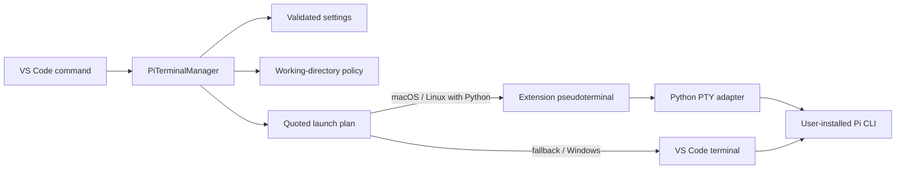

# Architecture

## Purpose

The extension is a thin editor integration around a user-installed Pi CLI. It
owns editor placement and terminal I/O adaptation; Pi owns conversations,
models, authentication, tools, extensions, and persistence.

## Runtime flow

`src/piTerminalManager.ts` is the only stateful coordinator. The remaining
modules either validate external inputs, build immutable plans, or adapt one
I/O boundary.

## Module boundaries

| Module | Responsibility |
| --- | --- |
| `configuration.ts` | Validate editor settings and apply bounded defaults. |
| `workingDirectory.ts` | Choose a home, first root, prompted root, or most-specific active root. |
| `launch.ts` | Quote executable arguments and produce platform-specific shell plans. |
| `pathMentions.ts` | Convert resources and confirmed file-drop payloads into Pi mentions. |
| `dropInterception.ts` | Recognize an editor moved into a Pi group and produce a reversible plan. |
| `titleParser.ts` | Parse bounded OSC title streams and compact Pi session names. |
| `pythonBridge.ts` | Detect standard-library Unix PTY support and build bridge arguments. |
| `piPseudoterminal.ts` | Connect VS Code terminal events to the child adapter process. |
| `piTerminalManager.ts` | Own live session identity, group reuse, commands, restoration, and cleanup. |
| `scripts/pi-pty-bridge.py` | Relay a real Unix PTY, resize it, verify path drops, and rewrite Pi OSC titles. |

## Session identity

Terminal labels are presentation state: several fresh chats may all be named
`Pi Coding Agent`, and two sessions may choose the same title. They are therefore
never used as identifiers. The manager stores `vscode.Terminal` objects in a
map, updates the exact active terminal from `onDidChangeActiveTerminal`, and
records its active editor column.

Only terminals created during the current extension-host lifetime are managed.
They are transient and are not restored by VS Code after reload. This prevents
the extension from accidentally adopting an unrelated terminal whose title
happens to start with “Pi.”

## Launch and quoting

`piAgent.command` is one executable name or path. `piAgent.args` is an array of
argument values. On POSIX systems every unsafe value is single-quoted. On
Windows, the configured executable and argument array are launched directly to
avoid `cmd.exe` environment expansion; command-line quoting is used only for
the optional profile mode.

The login shell is an environment bootstrap boundary, not an invitation to
shell syntax in settings. The final shell command uses `exec`, so Pi replaces
the bootstrap shell and exit status/lifecycle remain direct.

## Unix PTY adapter

VS Code pseudoterminals expose streams, while an interactive terminal program
expects a PTY. The dependency-free Python adapter creates that PTY, forwards
signals and window sizes, and relays bytes with partial-write handling.

Input is rewritten only when the complete chunk parses as absolute paths and
every path exists. OSC 0/1/2 titles whose heading is `π`, `Pi`, or
`Pi Coding Agent` are compacted; unrelated shell title messages are suppressed
so they cannot rename a fresh Pi tab. Partial OSC sequences are bounded at 8 KiB.

If Python or the Unix modules are absent, the manager creates a normal VS Code
terminal. Core commands and context-menu insertion remain available.

## Path movement

VS Code reports moving an editor between groups as a closed tab plus an opened
tab. The pure drop planner requires the same resource URI in both halves and a
destination column with a live Pi session. The manager closes the destination
copy, restores the original editor kind and column, then inserts its path into
the most recently active Pi terminal in that column.

## Published package

The VSIX contains compiled `out/*.js`, runtime assets, the Python adapter,
README, changelog, license, notice, and support document. Source, tests, CI, local editor files, source maps, and package artifacts are
excluded by `.vscodeignore`.
